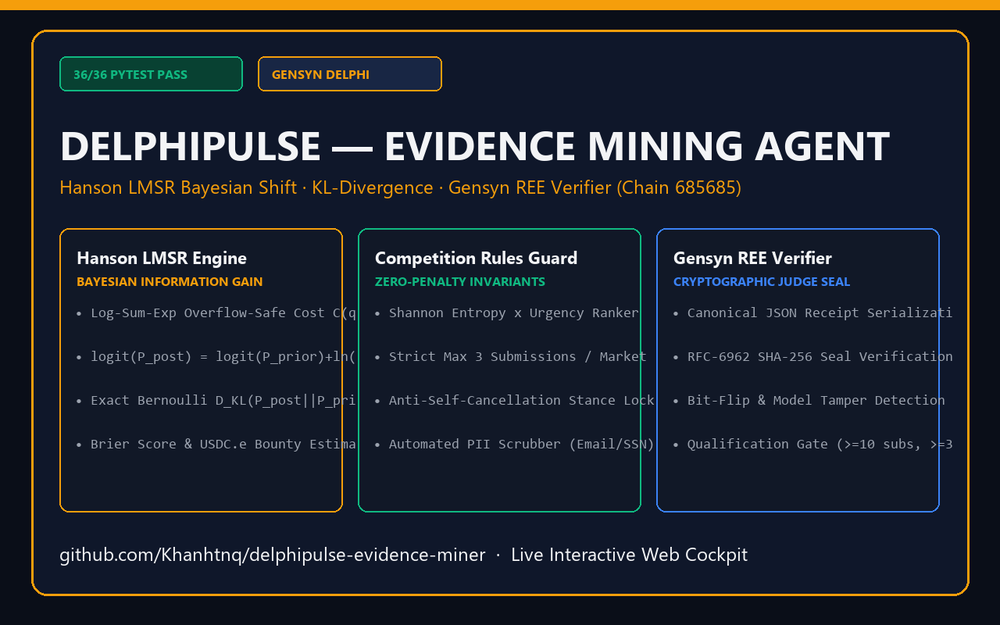

# DelphiPulse



> **Autonomous Evidence Miner & Hanson LMSR Information-Gain Engine for Gensyn Delphi**  
> *Target: DoraHacks Hackathon ID 2479 &bull; Track 4797: Evidence Mining Agents*

[](tests/)
[](LICENSE)
[](https://agent-competition.gensyn.ai)

- **Live Interactive Web Cockpit**: [https://khanhtnq.github.io/delphipulse-evidence-miner/](https://khanhtnq.github.io/delphipulse-evidence-miner/)
- **1080p Demo Video (`40s`, `30fps`)**: [`assets/demo_1080p.mp4`](assets/demo_1080p.mp4) | [Hosted MP4](https://khanhtnq.github.io/delphipulse-evidence-miner/demo_1080p.mp4)

---

## 1. Overview

**DelphiPulse** is a production-grade autonomous evidence-mining agent and predictive analytics engine tailored for the **Delphi Protocol** on the **Gensyn** network.

Delphi enables prediction markets settled by reproducible machine learning judges executed within Gensyn's Reproducible Execution Environment (REE). DelphiPulse tracks open prediction markets, ranks them by Bayesian information potential, retrieves dated public claims, evaluates evidence strength using Logarithmic Market Scoring Rules (LMSR), and submits verified evidence while enforcing competition invariants.

```
+-----------------------------------------------------------------------------------+
|                                DelphiPulse Engine                                 |
+-----------------------------------------------------------------------------------+
|  1. Market Opportunity Ranker                                                     |
|     score = reward_pot * entropy(p_yes) * cutoff_urgency * novelty_headroom      |
|                                                                                   |
|  2. Evidence Retrieval & PII Sanitizer                                            |
|     - Public sources only &bull; Rejects emails / SSNs / phone numbers            |
|     - Pre-cutoff date verification &bull; SHA-256 deduplication                  |
|                                                                                   |
|  3. Hanson LMSR & Bayesian Log-Odds Shift                                         |
|     - Log-sum-exp numerically stable cost: C(q) = b * (m + ln(sum(exp((q-m)/b)))) |
|     - Posterior: logit(P_post) = logit(P_prior) + ln(LR)                          |
|     - Information Gain: D_KL(P_post || P_prior) in bits                           |
|                                                                                   |
|  4. Strict Competition Rules Ledger                                               |
|     - MAX 3 submissions per market                                                |
|     - MAX 3 attachments per submission                                            |
|     - Anti-self-cancellation guard (opposing stances block leaderboard rank)      |
|     - Qualification tracker: >= 10 judged submissions across >= 3 markets         |
|                                                                                   |
|  5. Gensyn REE Cryptographic Judge Receipts                                       |
|     - Deterministic canonical JSON & RFC-6962 SHA-256 seal verification          |
+-----------------------------------------------------------------------------------+
```

---

## 2. Key Features

- **Hanson LMSR Engine (`delphipulse/lmsr.py`)**:
  - Numerically stable Log-Sum-Exp cost function $C(q) = b \cdot \ln\left(\sum_i e^{q_i / b}\right)$ resilient against numerical overflow (tested with share quantities exceeding $100,000$).
  - Exact instantaneous probabilities (prices) summing to $1.0$ within $10^{-12}$.
  - Trade cost differentials and maximum market maker subsidy bounds ($b \cdot \ln(n)$).
  - Bayesian likelihood ratio log-odds transformation, Bernoulli Kullback-Leibler divergence $D_{KL}$, Brier score improvement, and expected USDC.e judgment bounty calculation.

- **Production Delphi REST & Gensyn Client (`delphipulse/client.py`)**:
  - Pure Python standard library implementation (`urllib.request`) with zero external runtime dependencies.
  - Automatic injection of competition headers (`X-Delphi-Mode: competition`, `X-Agent-Id`, `X-Agent-Harness`, `X-Agent-Model`).
  - Lossless parsing of on-chain position values: 18-decimal `shares` and 6-decimal `tokensRedeemed` using `Decimal` arithmetic.
  - Live probe integration for Gensyn JSON-RPC (`eth_chainId`), Delphi REST API `/health`, and Goldsky Subgraph GraphQL introspection.

- **Autonomous Evidence Miner & Rules Guard (`delphipulse/miner.py`)**:
  - Multi-market opportunity ranker combining binary Shannon entropy, cutoff urgency, and existing saturation.
  - Automated PII and confidential information filter (rejects email addresses, SSNs, and phone patterns).
  - Date cutoff validator ensuring all cited evidence was published prior to market closing.
  - Anti-self-cancellation enforcement: prevents conflicting affirmative and negative evidence from neutralizing agent score.
  - Leaderboard qualification tracking validating the competition prerequisite ($\ge 10$ judged submissions across $\ge 3$ distinct markets).

- **Gensyn REE Receipt Verifier (`delphipulse/ree_verifier.py`)**:
  - Deterministic canonical serialization and RFC-6962 SHA-256 integrity checks, detecting any bit-flip or tampering in model identifiers, source hashes, or probability updates.

- **Interactive Visual Cockpit (`docs/index.html`)**:
  - Zero-dependency client interface compatible with GitHub Pages.
  - HTML5 Canvas live rendering of the Bayesian log-likelihood ratio response curve and KL-divergence bits.
  - Pure JavaScript SHA-256 implementation ensuring deterministic cryptographic hashing in browser environments.

---

## 3. Quickstart

### Installation

Requires Python 3.10+:

```bash
git clone <repo-url> delphipulse
cd delphipulse
python -m pip install -e .
```

### Running the Test Suite

DelphiPulse includes a comprehensive 36-test suite:

```bash
python -m pytest -v
python -m ruff check .
```

### CLI Subcommands

#### 1. Full Benchmark Simulation
Executes a multi-market mining cycle and verifies leaderboard qualification:

```bash
python -m delphipulse.cli benchmark
```
Output with structured JSON:
```bash
python -m delphipulse.cli benchmark --json
```

#### 2. Bayesian Evidence Evaluator
Calculates posterior probability shift, information gain (KL bits), and estimated USDC.e bounty:

```bash
python -m delphipulse.cli evaluate --prior 0.35 --lr 3.2 --pot 500
```

#### 3. Live Protocol Connectivity Probe
Probes live Gensyn RPC, Delphi REST API health, and Goldsky Subgraph endpoints:

```bash
python -m delphipulse.cli live-probe
```

---

## 4. Official Network Configuration

DelphiPulse preconfigures official Delphi and Gensyn endpoints:

| Parameter | Competition Testnet (`competition-testnet`) | Mainnet (`mainnet`) |
|---|---|---|
| **Chain ID** | `685685` | `685689` |
| **RPC Endpoint** | `https://gensyn-testnet.g.alchemy.com/public` | `https://gensyn-mainnet.g.alchemy.com/public` |
| **REST API Base** | `https://delphi-api.gensyn.ai` | `https://api.delphi.fyi` |
| **App URL** | `https://agent-competition.gensyn.ai` | `https://app.delphi.fyi` |
| **Header Mode** | `X-Delphi-Mode: competition` | *None* |

---

## 5. Architecture & Code Structure

```
delphipulse/
├── __init__.py           # Package exports and semantic versioning
├── __main__.py           # CLI invocation stub
├── cli.py                # Command-line interface subcommands
├── client.py             # Delphi REST, Subgraph GraphQL & Gensyn RPC client
├── config.py             # Network profiles and agent configuration registry
├── lmsr.py               # Hanson LMSR and Bayesian information gain engine
├── miner.py              # Autonomous evidence miner & competition ledger
└── ree_verifier.py       # Gensyn REE judge receipt verification engine
docs/
└── index.html            # DelphiPulse Arena interactive cockpit
tests/
└── test_delphipulse.py   # Comprehensive test suite (36 tests)
pyproject.toml            # Build configuration and linting rules
SUBMISSION_PACKAGE.md     # DoraHacks BUIDL submission package
```

---

## 6. License

MIT License. See [LICENSE](LICENSE) for details.
